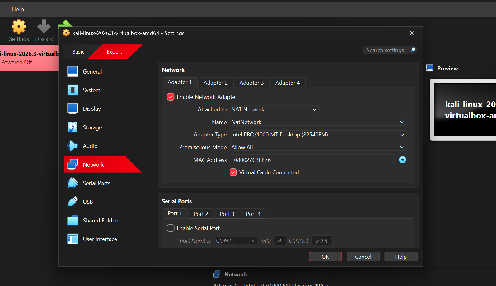

# WK1-PM1: Cybersecurity Testing Lab Setup

## 1. Project Overview

Successfully configured a cybersecurity testing lab using Oracle VirtualBox and Kali Linux.

## 2. Tools Used

- Oracle VirtualBox
- Kali Linux
- 7-Zip
- Windows Host OS

## 3. Network Configuration

| Configuration | Value |
|---|---|
| Network Name | CyberLab |
| Network Type | NAT Network |
| Network Subnet | 10.0.0.0/24 |
| Kali Linux IP | 10.0.0.2/24 |
| Gateway | 10.0.0.1 |
| DNS | 1.1.1.1, 8.8.8.8 |

## 4. Tasks Completed

- Installed 7-Zip.
- Installed VirtualBox.
- Created NAT Network.
- Imported Kali Linux.
- Configured static IP address.
- Enabled shared clipboard.
- Enabled drag and drop.
- Configured shared folder.
- Verified internet connectivity.
- Created VM snapshot.

## 5. Network Testing

Commands used:
ip addr
ip route
ping -c 4 10.0.0.1
ping -c 4 8.8.8.8
ping -c 4 google.com
## 6. Shared Folder

- Host: Windows
- Kali: /downloads

## 7. Learning Outcomes

- Virtual machine configuration.
- NAT networking.
- Static IP configuration.
- Linux networking commands.
- Shared folder configuration.
- Internet connectivity testing.

## 8. Lab Screenshots

### 1. Kali Linux Installation

### 2. Network Configuration

### 3. VirtualBox Setup

---

**Project:** WK1-PM1 Cybersecurity Lab

**Status:** Completed
